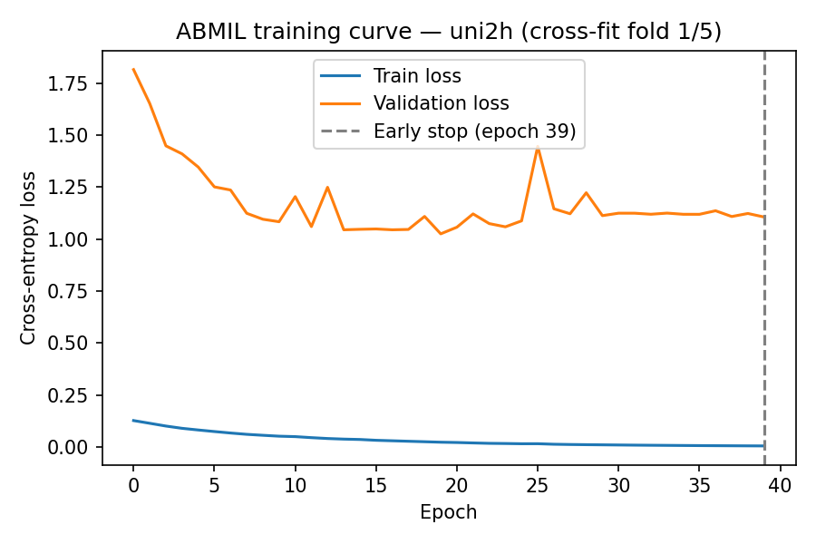
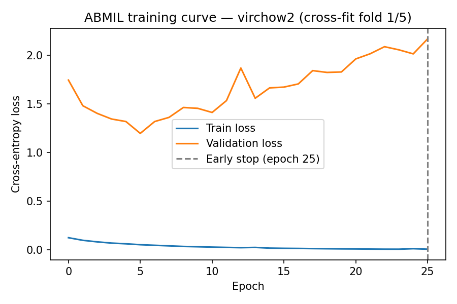
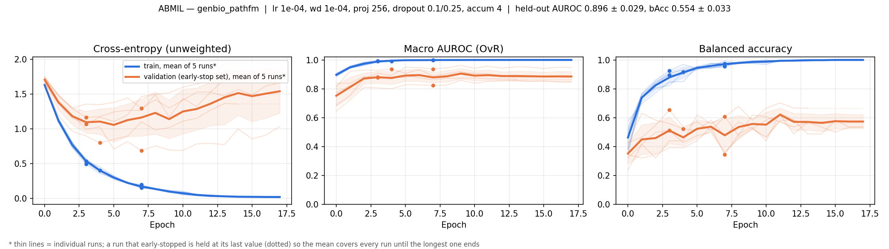

# Lung Adenocarcinoma Subtyping: Foundation-Model Fusion Agent

## Overview

Predicts a 7-class lung adenocarcinoma subtype from whole-slide images by fusing three pathology foundation models (UNI2-h, Virchow2, GenBio-PathFM) with age/sex, via an agent that searches fusion strategies and reports a held-out test comparison. Two tile-pooling methods are compared: mean pooling and attention-based pooling (ABMIL).

---

## 1. Data

- Source: `CLWD.csv` + WSIs from `kmmuleelab/Lung_Pathology_Image_JPG`.
- Patients grouped by `SampleNumber` (merges one duplicate ID); one slide/patient kept (lowest `WSI_ID`). Label = `Benchmark_Label_7class` on that slide. 5 patients have conflicting labels across slides (flagged, not dropped).
- Sanity check: "lowest WSI_ID" rule agrees with a patient's other slides 97.9% of the time (143/146), no systematic bias.
- Split: stratified 70/10/20, seed 42 → 146 train / 21 val / 42 test.
- 12 patients' `WSI_ID`s never resolved to a file and are dropped entirely (need all 3 models' embeddings). **Effective n = 197**, not 209. 4 of the 12 were test patients → confusion matrix sums to 38, not 42.

---

## 2. Tiling & Tissue Detection

| Step | Detail |
|---|---|
| Downsample | 80x→20x via PIL `.draft()` (519MB→89MB peak memory) |
| Tissue mask | HSV saturation + Otsu, on 8x-downsampled thumbnail |
| Tile size | 224×224, non-overlapping, ≥50% tissue |
| Cap | 600 tiles/slide, seeded random subset if exceeded |

A whole-slide image is gigapixel-sized: loading one at full resolution, or building its tissue mask from a full-resolution copy, used enough RAM to crash free-tier Colab's ~12GB limit on a realistic slide. The `.draft()` downsample and the 8x-downsampled mask both cut that peak memory down before anything large gets held in memory at once. The measured 519MB→89MB figure above is what made tiling actually finish instead of crashing partway through a slide.

---

## 3. Foundation Models

| Model | Dim | Notes |
|---|---|---|
| UNI2-h | 1536 | ViT-H/14 via `timm` |
| Virchow2 | 2560 | class token + mean-pooled patch tokens, registers excluded |
| GenBio-PathFM | 4608 | own normalization, via `transformers` |

All frozen, pretrained, never fine-tuned. Only the classifier(s) on top are trained. Extraction split into two Colab-memory-friendly stages: tile once, then embed one model at a time.

---

## 4. Tile Pooling: Mean vs. ABMIL

- **Mean pooling:** average all tile embeddings. No parameters, can't leak.
- **ABMIL** (attention-based pooling): small trainable network learns a per-tile attention weight, pools by weighted average. Trained per foundation model with Adam, class-weighted cross-entropy, early-stopped on held-out loss.

**Bug caught:** my first version trained one ABMIL network on the 146 train patients and used it to pool everyone, including those same patients, so train/val vectors came from a network that had already seen their labels (too clean), while test vectors didn't (realistic). A downstream classifier trained on the clean vectors underperformed on the realistic ones.

**Fix (cross-fitting, `02d_crossfit_abmil.py`):** split train+val into 5 groups; for each, train a fresh network on the other 4 and pool only the held-out group. Test patients are pooled by all 5 networks and averaged. Verified on synthetic no-signal data (old: CV AUROC 0.73; cross-fit: 0.59, matching mean pooling) and on the real gap between ABMIL's own out-of-fold and test scores (shrinks from 0.10–0.15+ to 0.02–0.05 after the fix). All ABMIL numbers below use the cross-fitted version.

**Training curves (one representative fold):** figures below show train/validation loss per epoch for fold 1 of 5 for each model. Train loss falls smoothly toward 0 on all three, and early stopping fires once validation loss stops improving. uni2h and GenBio-PathFM plateau noisily. Virchow2's validation loss climbs after an early minimum at epoch 5, which is overfitting in this fold. This is one fold out of five; it illustrates the training dynamics, not a claim that every fold behaves identically.

**uni2h**

**Virchow2**

**GenBio-PathFM**

---

## 5. Fusion Strategies

| Family | Approach |
|---|---|
| Early | Concatenate all 3 embeddings (+ optional L2-norm/PCA) + metadata → logistic regression |
| Late | One classifier per model + metadata, combined via mean / weighted / stacking |
| Learned | Small gated network learning per-patient weighting across the 3 streams |

Age/sex included in every family. Each pooling method runs through the identical search independently.

---

## 6. Agent Search

Deterministic proposer (no LLM key, would degrade anyway). Seed phase: one config per family (7 total). Then explore/exploit 50/50: explore tries a fresh random config; exploit perturbs one hyperparameter of the current best. A new config only replaces the incumbent if it beats it by more than standard error (paired, over 5-fold×3-repeat CV). Stops after 12 trials with no accepted improvement.

### 6.1 Bugs found and fixed

1. **"Weighted" combine wasn't weighted**: no real weight values were defined, so it silently fell back to an even split (identical to "mean"). Caught by two trials scoring identically. Fixed with real weight options.
2. **Significance test used the wrong statistic**: compared configs' independent variances instead of paired, fold-by-fold differences, so a real but consistent gain looked like noise. Fixed to a paired comparison.
3. **Exploit built on rejected configs**: "current best" was the highest-scoring trial ever, even if rejected. Fixed to only build on *accepted* configs.
4. **Stacking trained on in-sample predictions**: the per-model classifiers predicted on the same patients they were trained on, so the meta-classifier learned from unrealistically accurate inputs. Fixed with out-of-fold predictions.
5. **ABMIL pooling leak**: see §4.

Each fix was verified independently against synthetic data.

### 6.2 Trial history (mean pooling)

| Trial | Config | CV AUROC | Result |
|---|---|---|---|
| 1 | early, l2_normalize=True | 0.8192 | Accepted |
| 2 | early, l2_normalize=False | 0.8262 | Rejected (not significant) |
| 3 | early + PCA=128 | 0.8192 | Rejected |
| 4 | late, mean | 0.8369 | **Accepted** |
| 5 | late, weighted [0.6,0.2,0.2] | 0.8403 | **Accepted** |
| 6–17 | stacking, learned net, other variants | ≤0.8403 | All rejected |

**Final (mean pooling):** late fusion, weighted [0.6,0.2,0.2], C=1.0, CV score 0.8403.

### 6.3 Trial history (ABMIL, cross-fitted)

The identical search, run again on the cross-fitted ABMIL embeddings:

| Trial | Config | CV AUROC | Result |
|---|---|---|---|
| 1 | early, l2_normalize=True | 0.8786 | Accepted (first trial) |
| 2 | early, l2_normalize=False | 0.8470 | Rejected (not significant) |
| 3 | early, l2_normalize=True, PCA=128 | 0.8787 | **Accepted** |
| 4 | late, mean | 0.8700 | Rejected |
| 5 | late, weighted [0.6,0.2,0.2] | 0.8750 | Rejected |
| 6 | late, stacking | 0.8506 | Rejected |
| 7 | learned | 0.8617 | Rejected |
| 8–15 | further early/late/learned variants | ≤0.8787 | All rejected |

Agent stopped at trial 15 (12 consecutive rejects after trial 3's acceptance). **Final (ABMIL):** early fusion, l2_normalize=True, PCA=128, C=1.0, CV score 0.8787.

Each CV AUROC above comes from 5-fold × 3-repeat CV, so every trial's score is itself averaged across the same grouped folds as the cross-fit ABMIL training in §4. This table is the fusion agent's own evidence of training/evaluation across those groups, separate from the per-epoch training curve shown there.

---

## 7. Results (Test Set, Touched Once Per Pooling Method)

| Row | Mean pooling | ABMIL (cross-fit) |
|---|---|---|
| Metadata only | 0.7251 | — |
| UNI2-h alone | 0.8441 | 0.8049 |
| Virchow2 alone | 0.8191 | 0.8106 |
| GenBio-PathFM alone | 0.8117 | 0.7705 |
| Best single model + metadata | 0.8433 (UNI2-h) | — |
| Fused + metadata | 0.8318 | 0.8213 |
| Fused balanced accuracy | 0.415 | 0.447 |

95% bootstrap CI (fused, mean pooling): AUROC [0.755, 0.903]. UNI2-h (0.843) and fused ABMIL (0.821) both sit inside it, so they are not statistically distinguishable.

**ABMIL's own head** (no separate classifier on top):

| Model | OOF train+val | Test |
|---|---|---|
| UNI2-h | 0.8433 | 0.8217 |
| Virchow2 | 0.8518 | 0.8178 |
| GenBio-PathFM | 0.8656 | 0.8018 |

### Confusion Matrix (Fused, Mean Pooling, n=38)

| True \ Pred | Acinar | Cribri. | In situ | Lepidic | Micropap. | Papillary | Solid | Recall |
|---|---|---|---|---|---|---|---|---|
| Acinar (7) | 5 | 0 | 0 | 0 | 0 | 1 | 1 | 0.71 |
| Cribriform (2) | 0 | 0 | 0 | 0 | 0 | 0 | 2 | 0.00 |
| In situ (8) | 0 | 0 | 5 | 1 | 0 | 2 | 0 | 0.63 |
| Lepidic (4) | 0 | 0 | 2 | 0 | 1 | 1 | 0 | 0.00 |
| Micropap. (5) | 0 | 0 | 0 | 0 | 2 | 1 | 2 | 0.40 |
| Papillary (6) | 1 | 0 | 0 | 1 | 0 | 4 | 0 | 0.67 |
| Solid (6) | 1 | 1 | 0 | 0 | 1 | 0 | 3 | 0.50 |

Per-class AUROC: Acinar 0.949 · Cribriform 0.792 · In situ 0.921 · Lepidic 0.706 · Micropapillary 0.752 · Papillary 0.823 · Solid 0.880

---

## 8. Explanation

The results suggest UNI2-h is the strongest of the three foundation models alone. Fused and ABMIL both perform similarly to it, though UNI2-h is marginally better under both pooling methods. The agent's weighted 60/20/20 config is a real, CV-verified improvement over an even split, reflecting that UNI2-h is the strongest model alone. Even weighted, the other two models pull predictions slightly away from what UNI2-h alone would say, and on 38 test patients that costs slightly more than it gains. A learned per-patient weighting did no better than the fixed ratio. With only 146 training patients, there isn't much room for any fusion method to separate itself from the single best model. The bootstrap CI reflects this: UNI2-h's score falls inside the fused model's own confidence interval, so the two aren't statistically distinguishable.

Switching to ABMIL pooling doesn't change this conclusion. UNI2-h and Virchow2 land close to their mean-pooling scores (Virchow2 is within noise). GenBio-PathFM drops more (0.812 → 0.771). I don't have a confirmed reason for this and won't guess at one past this: it's the one model where cross-fitting leaves each of the 5 networks with meaningfully less training data (~115-120 patients instead of one network's full 146), so it's a plausible suspect, but I haven't tested it directly and don't want to present it as established. All fused scores (mean 0.832, ABMIL 0.821) sit within ~0.01 of each other.

The confusion matrix shows a problem no fusion or pooling choice fixes: Lepidic and Cribriform have only 6 test patients combined and 0% recall, too few examples to learn what separates them from visually similar classes. That's also why balanced accuracy (0.415) trails macro AUROC (0.832) so much.

Next steps:
- **Calibrate each model's probabilities before combining them.** Late fusion's "mean" and "weighted" options work by averaging the three models' predicted class probabilities together (each per-model classifier already outputs these; nothing fake or extra, it's what `predict_proba` already produces). The issue: one model's "70% confident" doesn't necessarily mean the same thing as another's "70% confident". One could be a more reliable confidence than the other. Averaging them as-is treats both as equally trustworthy. Calibration means checking each model's stated confidence against how often it's actually right, and adjusting it if it's off, before averaging. This is a nice-to-have, not something broken in the current results. Worth flagging as future work, not required.
- **Give learned fusion real early stopping.** Right now it trains for a fixed number of epochs regardless of whether it's still improving. ABMIL (§4) already stops early once a held-out loss stops improving, so doing the same for learned fusion would be a small, consistent change.

---

## 9. What I'd do with 10x compute

- **LLM proposer** instead of deterministic search (`LLMProposer` already exists, unused here), could reason about *why* a trial failed instead of moving to the next random guess.
- **Multiple train/val/test splits**, not just CV folds within one split. Everything here comes from one 146/21/42 split.

---

## 10. Why this isn't overfitting to validation

Every trial score comes from 15 CV scores (5-fold × 3-repeat) averaged together, not one run against the 21-patient val set. A config only replaces the incumbent via a proper paired significance test. The 38-patient test set was touched once per pooling method, after each search finished. This holds immediately for mean pooling: it has no trainable parameters at all, so there's nothing in it that could have seen a label and memorized it. For ABMIL, this required the cross-fitting fix described in §4, which I checked against synthetic data with no real signal to confirm it actually removed the leak.
