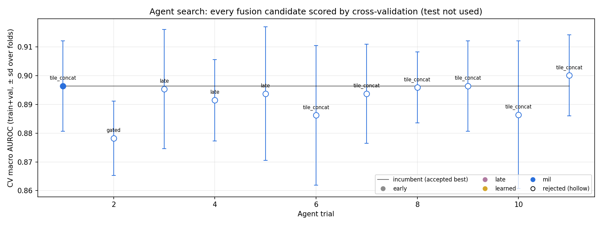
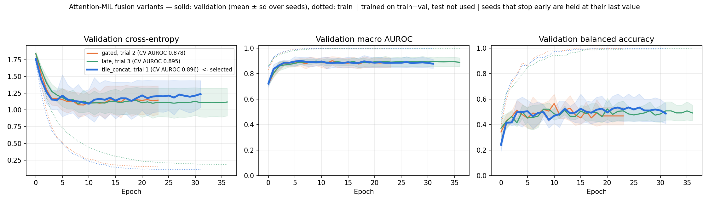
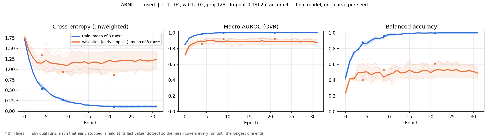

# Lung Adenocarcinoma Subtyping: Foundation-Model Fusion Agent

## Overview

Predicts a 7-class lung adenocarcinoma subtype from whole-slide images by fusing three pathology foundation models (UNI2-h, Virchow2, GenBio-PathFM) with age/sex, via an agent that searches fusion strategies and reports a held-out test comparison. Two tile-pooling methods are compared: mean pooling and attention-based pooling (ABMIL). The agent selected attention-based fusion of all three models (`tile_concat`) + age/sex.

---

## Pipeline Overview

| # | Step | Script | Data used |
|---|---|---|---|
| 1 | Patient-level stratified split, data quirks | `src/data/make_split.py` | CSV |
| 2 | Tissue mask + tiling at 20x | `scripts/02a_tile_slides.py` | all slides, once |
| 3 | Tile embeddings from the 3 frozen models, cached | `scripts/02b_extract_embeddings.py` | all slides, once |
| 4 | Per-model ABMIL hyper-parameter search | `scripts/02g_tune_abmil.py` | train+val (5-fold CV) |
| 5 | Per-model ABMIL + training curves | `scripts/02d_crossfit_abmil.py`, `02e` | train+val (5-fold CV) |
| 6 | Agent fusion search | `scripts/03_run_agent.py` | train+val (5-fold CV) |
| 7 | Final models + comparison table | `scripts/03_run_agent.py` | test, once |
| 8 | Plots | `scripts/04_plot_fusion_variants.py`, `02e` | saved results |

Steps 1–6 never see the test set. `notebooks/lung_agent.ipynb` runs everything on Colab; the README has the exact commands. Seeds: 42 (split, CV), 1000–1002 (the 3 final training runs).

---

## 1. Data

- Source: `CLWD.csv` + WSIs from `kmmuleelab/Lung_Pathology_Image_JPG`.
- Patients grouped by `SampleNumber` (merges one duplicate ID); one slide/patient kept (lowest `WSI_ID` that exists in the repo). Label = `Benchmark_Label_7class` on that slide. 5 patients have conflicting labels across slides (flagged, not dropped).
- Sanity check: "lowest WSI_ID" rule agrees with a patient's other slides 97.9% of the time (143/146), no systematic bias.
- Split: stratified 70/10/20, seed 42 → 146 train / 21 val / 42 test.
- 6 patients' lowest `WSI_ID` is missing from the repo, so their next slide is used. 6 more patients have no slide in the repo at all and are dropped (need all 3 models' embeddings). **Effective n = 203**, not 209. 1 of the 6 was a test patient → test n = 41, and the confusion matrix sums to 41.

---

## 2. Tiling & Tissue Detection

| Step | Detail |
|---|---|
| Downsample | 80x→20x via PIL `.draft()` (519MB→89MB peak memory) |
| Tissue mask | HSV saturation + Otsu, on 8x-downsampled thumbnail |
| Tile size | 224×224, non-overlapping (stride 224), ≥50% tissue |
| Cap | 600 tiles/slide, seeded random subset if exceeded |

A whole-slide image is gigapixel-sized: loading one at full resolution, or building its tissue mask from a full-resolution copy, used enough RAM to crash free-tier Colab's ~12GB limit on a realistic slide. The `.draft()` downsample and the 8x-downsampled mask both cut that peak memory down before anything large gets held in memory at once. The measured 519MB→89MB figure above is what made tiling actually finish instead of crashing partway through a slide.

---

## 3. Foundation Models

| Model | Dim | Preprocessing / output | Embedding time |
|---|---|---|---|
| UNI2-h | 1536 | its own image normalisation; loaded with `timm` | 3,695 s for 197 slides |
| Virchow2 | 2560 | its own image normalisation; summary token + average of the patch tokens | 3,804 s for 197 slides |
| GenBio-PathFM | 4608 | its own image normalisation; loaded with `transformers` | 14,891 s for 177 of 197 slides |

All frozen, pretrained, never fine-tuned. Only the classifier(s) on top are trained. Extraction split into two Colab-memory-friendly stages: tile once, then embed one model at a time. GenBio-PathFM replaces Prism2 because Prism2 access wasn't granted.

---

## 4. Tile Pooling: Mean vs. ABMIL

- **Mean pooling:** average all tile embeddings.
- **ABMIL** (attention-based pooling): small trainable network learns a per-tile attention weight, pools by weighted average. Trained per foundation model with the AdamW optimizer, class-weighted cross-entropy, early-stopped on held-out loss (the best epoch is kept).

**Bug caught:** my first version trained one ABMIL network on the 146 train patients and used it to pool everyone, including those same patients, so train/val vectors came from a network that had already seen their labels (too clean), while test vectors didn't (realistic). A downstream classifier trained on the clean vectors underperformed on the realistic ones.

**Fix (cross-fitting, `02d_crossfit_abmil.py`):** split train+val into 5 groups; for each, train a fresh network on the other 4 and pool only the held-out group. Test patients are pooled by all 5 networks and averaged. Verified on synthetic no-signal data (old: CV AUROC 0.73; cross-fit: 0.59, matching mean pooling) and on the real gap between ABMIL's own out-of-fold and test scores (shrinks from 0.10–0.15+ to 0.02–0.05 after the fix). All ABMIL numbers below use the cross-fitted version.

**Per-model settings (`02g_tune_abmil.py`):** the three models produce different-sized embeddings, so one shared set of settings doesn't suit all of them. Each model gets its own search: 17 settings (learning rate, weight decay, dropout, projection size, label smoothing, tiles per step), each scored by 5-fold CV on train+val, keeping the lowest held-out loss.

| Model | Selected | CV AUROC | CV bal. acc. |
|---|---|---|---|
| UNI2-h | lr 5e-5, dropout 0.3/0.5, wd 1e-2 | 0.901 | 0.621 |
| Virchow2 | lr 1e-4, dropout 0.1/0.25, wd 1e-4 | 0.896 | 0.492 |
| GenBio-PathFM | lr 1e-4, dropout 0.1/0.25, wd 1e-4 | 0.896 | 0.554 |

**Training curves (all 5 folds):** the figures below show train and validation loss, macro AUROC and balanced accuracy per epoch, for every fold. Thin lines are folds and the bold line is their mean; a fold that stopped early is held at its last value. Train loss falls smoothly toward 0 on all three, and early stopping fires once validation loss stops improving.

- **UNI2-h:** validation loss decreases and plateaus.
- **Virchow2 and GenBio-PathFM:** validation loss decreases to a minimum around epochs 4–7, then rises slowly while validation AUROC stays flat. The model becomes over-confident rather than worse at ranking, and early stopping keeps the weights from the minimum.

**uni2h**

**Virchow2**

**GenBio-PathFM**

---

## 5. Fusion Strategies

| Pooling | Strategy | Approach |
|---|---|---|
| Mean pooling | Early | Concatenate all 3 embeddings + metadata → logistic regression |
| Mean pooling | Late | One classifier per model + metadata, combined via mean / weighted / stacking |
| Mean pooling | Learned | Small network that learns how much weight to give each model, per patient |
| ABMIL | tile_concat | Join the 3 models' embeddings for every tile, then one ABMIL over the joined tiles |
| ABMIL | gated | One ABMIL per model (3 slide vectors), then a small learned layer (a "gate") gives each model a weight per slide, adding to 1 |
| ABMIL | late | One full ABMIL classifier per model, their predictions averaged |

Age/sex included in every strategy. The ABMIL strategies also randomly hide one whole model during training ("stream dropout"), so the network can't rely on just one, and use each model's learning rate from §4.

---

## 6. Agent Search

Deterministic proposer: the agent picks the next config with fixed rules instead of an LLM (no LLM key), so the same run always makes the same choices. Seed phase: one config per strategy, so every option gets tried. Then explore/exploit 50/50: explore tries a fresh random config; exploit changes one setting of the current best. Every config is scored by 5-fold CV on train+val, using the same 5 folds each time. A new config only replaces the current best if, compared fold by fold, it wins by more than the fold-to-fold noise (one standard error). Stops after 8 trials in a row with no improvement (counted after the seed phase), with a 20–25 trial budget. Every trial is logged in `decision_log.jsonl`.

### 6.1 Bugs found and fixed

1. **"Weighted" combine wasn't weighted**: no real weight values were defined, so it silently fell back to an even split (identical to "mean"). Caught by two trials scoring identically. Fixed with real weight options.
2. **Accept test didn't compare fold by fold**: the new and current configs were scored on the same folds, but the test compared their overall averages as if they were unrelated, not fold by fold. That made the noise look bigger than it is, so real, consistent gains got rejected. Fixed: it now compares the two on each fold.
3. **Exploit built on rejected configs**: "current best" was the highest-scoring trial ever, even if rejected. Fixed to only build on *accepted* configs.
4. **Stacking trained on in-sample predictions**: the per-model classifiers predicted on the same patients they were trained on, so the meta-classifier learned from unrealistically accurate inputs. Fixed with out-of-fold predictions.
5. **ABMIL pooling leak**: see §4.
6. **Patience counted during the seed phase**: the agent could stop before the ABMIL strategies were ever tried. Fixed to count only after every variant has had a trial; duplicate configs are also skipped now.

Each fix was verified independently against synthetic data.

### 6.2 Trial history, run 1 (all six strategies: mean pooling and ABMIL)

| Trial | Config | CV AUROC | Result |
|---|---|---|---|
| 1 | mean pooling, early, l2_normalize=True | 0.8201 | Accepted (first trial) |
| 2 | mean pooling, early, l2_normalize=False | 0.8414 | **Accepted** |
| 3–7 | mean pooling: early + PCA, late (mean / weighted / stacking), learned | 0.8105–0.8407 | All rejected |
| 8 | ABMIL, tile_concat | 0.8941 | **Accepted** |
| 9 | ABMIL, gated | 0.8817 | Rejected |
| 10 | ABMIL, late | 0.8953 | Rejected (not significant) |
| 11–18 | further mean-pooling and ABMIL configs | ≤0.8941 | All rejected |

ABMIL fusion clearly beat mean-pooling fusion (0.894 vs ≤0.842).

### 6.3 Trial history, run 2 (final: ABMIL strategies only)

The same search on the three ABMIL strategies, with the per-model settings from §4:

| Trial | Config | CV AUROC | Result |
|---|---|---|---|
| 1 | tile_concat | 0.8964 | Accepted (first trial) |
| 2 | gated | 0.8782 | Rejected |
| 3 | late | 0.8954 | Rejected (not significant) |
| 4–5 | late, other dropout / projection | 0.8915, 0.8938 | Rejected |
| 6–10 | tile_concat, other dropout / stream dropout / tiles | 0.8862–0.8964 | Rejected |
| 11 | tile_concat, lr 2e-4, dropout 0.5 | 0.9001 | Rejected (not significant) |

Agent stopped at trial 11 (8 consecutive rejects). **Final:** tile_concat, projection 128, dropout 0.25, stream dropout 0.2, lr 1e-4, label smoothing 0.1, 256 tiles per step, CV score 0.8964.

The three ABMIL strategies train similarly: validation AUROC about 0.88–0.90 for all of them, and flat validation loss for gated and late.

---

## 7. Results (Test Set, n = 41)

Each cell is **macro AUROC (balanced accuracy)**. Each ABMIL row is the average of 3 independently trained seeds.

| Row | Mean pooling | ABMIL |
|---|---|---|
| Metadata only | 0.690 (0.345) | — |
| UNI2-h alone | 0.843 (0.410) | 0.813 (0.474) |
| Virchow2 alone | 0.812 (0.326) | 0.816 (0.353) |
| GenBio-PathFM alone | 0.809 (0.426) | 0.833 (0.429) |
| Best single model + metadata | 0.842 (0.458), UNI2-h | 0.830 (0.429), GenBio-PathFM |
| **Fused (agent-selected) + metadata** | — | **0.820 (0.450)** |

The last row is the fused model the agent selected. It is an ABMIL model (the agent picked ABMIL fusion over mean-pooling fusion, CV 0.894 vs ≤0.842), so it sits in the ABMIL column and compares directly with the ABMIL single models.

**Uncertainty.** With only 41 test patients, a score depends a lot on which patients happen to be in the test set. To measure this, I resampled the test patients 2,000 times and recomputed the scores (bootstrap):

- Fused model, 95% range: AUROC 0.734–0.894, balanced accuracy 0.285–0.616.
- Fused minus the best ABMIL single model (GenBio-PathFM + metadata), on the same resamples: AUROC −0.011 (range −0.045 to +0.027), balanced accuracy +0.022 (range −0.048 to +0.096). Both ranges include 0, so the two are effectively tied.
- Training each ABMIL model 3 times with different random starts moves its AUROC by about 0.01–0.02 (fused: 0.814 ± 0.014).

### Confusion Matrix (Fused, n=41)

| True \ Pred | Acinar | Cribri. | In situ | Lepidic | Micropap. | Papillary | Solid | Recall |
|---|---|---|---|---|---|---|---|---|
| Acinar (7) | 5 | 0 | 0 | 0 | 0 | 1 | 1 | 0.71 |
| Cribriform (3) | 1 | 1 | 0 | 0 | 0 | 0 | 1 | 0.33 |
| In situ (9) | 0 | 0 | 5 | 1 | 0 | 3 | 0 | 0.56 |
| Lepidic (4) | 1 | 0 | 1 | 1 | 1 | 0 | 0 | 0.25 |
| Micropap. (5) | 0 | 0 | 0 | 0 | 1 | 1 | 3 | 0.20 |
| Papillary (7) | 0 | 0 | 1 | 1 | 2 | 3 | 0 | 0.43 |
| Solid (6) | 0 | 1 | 0 | 0 | 1 | 0 | 4 | 0.67 |

Per-class AUROC: Acinar 0.975 · Cribriform 0.877 · In situ 0.806 · Lepidic 0.736 · Micropapillary 0.711 · Papillary 0.723 · Solid 0.910

**Fused model training curves** (3 seeds, train+val; test not used):

---

## 8. Explanation

All image models land within about 0.03 AUROC of each other (0.81–0.84). UNI2-h with mean pooling has the highest single number (0.843) and GenBio-PathFM is the strongest ABMIL model (0.833). The fused model reaches 0.820 AUROC and the highest balanced accuracy of the ABMIL models (0.450 vs 0.429 for GenBio-PathFM). So fusion performs about the same as the best single models: slightly lower on AUROC, slightly higher on balanced accuracy, and well within each other's uncertainty ranges. Cross-validation on the larger train+val set shows the same thing: fused 0.896 vs 0.896–0.901 for the single ABMIL models.

This suggests the three foundation models capture largely the same information for this task, so combining them adds little. With only 162 train+val patients and 41 test patients (3–9 per class), there also isn't much room for any fusion method to separate itself from the single best model. Switching to ABMIL pooling doesn't change this conclusion, but per-model tuning did fix one earlier issue: GenBio-PathFM used to drop under ABMIL (0.812 → 0.771) and now improves (0.809 → 0.833). Age/sex add almost nothing on top of the images (UNI2-h: 0.843 alone vs 0.842 with metadata).

The confusion matrix shows the classes with the fewest test patients (Cribriform 3, Lepidic 4, Micropapillary 5) have the lowest recall: too few examples to learn what separates them from similar classes. Most errors come from a few pairs (In situ predicted as Papillary, Micropapillary predicted as Solid), and the best single model makes the same mistakes. That's also why balanced accuracy (0.450) trails macro AUROC (0.820) so much.

---

## 9. What I'd do with 10x compute

- **LLM proposer** instead of deterministic search (`LLMProposer` already exists, unused here), could reason about *why* a trial failed instead of moving to the next random guess.
- **Multiple train/val/test splits**, not just CV folds within one split. Everything here comes from one 146/21/42 split.
- **All 408 slides**, one bag per patient across all their slides, for more training data and less label noise from picking one slide.

---

## 10. Why this isn't overfitting to validation

Every trial score comes from 5-fold CV over all 162 train+val patients (15 scores for the logistic-regression families, 5 for the ABMIL strategies), not one run against the 21-patient val set. A config only replaces the incumbent via a proper paired significance test, the trial budget is small, and hyper-parameters for each model were chosen the same way (§4). The 41-patient test set was only used after each search finished, once per pipeline version; earlier versions gave very similar fused scores (0.832 with mean pooling, 0.821 with the first ABMIL, 0.827 with the first version of the current pipeline), all within the same confidence interval. For ABMIL, avoiding leakage required the cross-fitting fix described in §4, which I checked against synthetic data with no real signal to confirm it actually removed the leak.
